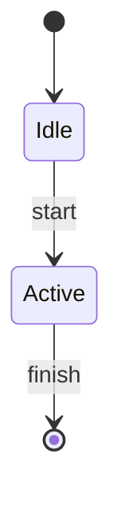

# Finite automata documentation

Document each system in `docs/automata/<system>.md`, then add its user stories to `docs/user-stories.md`.

## Implicit state machines

Document every implicit state machine found in the code, even if it is never made explicit. Mark it `Status: implicit` and list where its state lives in the code. Making it explicit is a refactor that needs the user's go-ahead first. See the `fix-bug` skill and the `state-machine-analyst` agent.

## Separate every statement by source

Apply this at any level of abstraction, down to a single state or transition. Be aggressive in identifying these distinctions.

- `[AUDIT]`: confirmed by an independent audit. Name the audit.
- `[PROMPT P-###]`: stated in a prompt. Quote it exactly.
- `[UNDERSTANDING]`: Claude's own understanding, not yet confirmed.

Never upgrade a statement to a stronger source without new evidence.

## Automaton file

````markdown
# <System>

Status: explicit | implicit
Code locations: <file:line list where the state lives>
Decision: explicit by design | keep implicit | make explicit, awaiting approval | made explicit (#issue)
Analysis: <link to the state-machine-analyst report, if any>

## Diagram



## States

| State | Meaning | Source |
|---|---|---|

## Transitions

| From | Event | Guard | To | Source |
|---|---|---|---|---|

## Unknowns

Every combination of state and event with no defined behaviour.
````

List every state, the initial state, the final states, and every transition. Treat each undefined state and event combination as an unknown, not as "nothing happens".

## User stories

Each transition gets at least one story:

```markdown
### US-001: <title>

Automaton: <system>, <from> → <to>
Source: [PROMPT P-###] "<quote>"

As a <role>, I want <goal>, so that <benefit>.

Acceptance criteria:
- Given <state>, when <event>, then <result>.
```

Use the transitions, guards and unknowns to find equivalence partitions and boundary values for tests.
