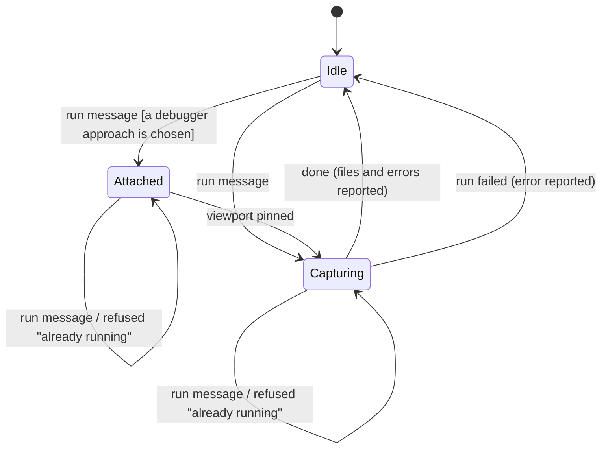
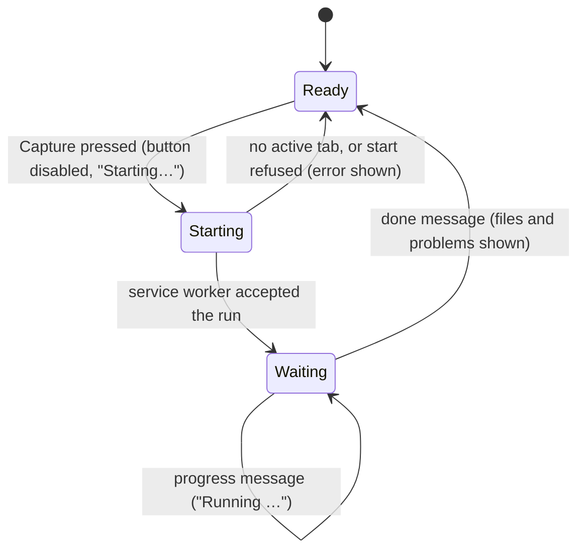

# Capture extension run

Status: implicit
Code locations:
- `extension/src/background.ts`, `createRunner`: the `busy` flag
- `extension/src/host-extension.ts`: the `attached` flag and `lastCapture` (the 600 ms gap between shots)
- `extension/src/popup.ts`: the Capture button's `disabled` state and the status line
- `extension/src/core/pipeline.ts`, `run`: the debugger is attached only while a debugger approach runs

Decision: keep implicit. [UNDERSTANDING] One flag and one attach/detach pair in a `try`/`finally`. Not analysed by `state-machine-analyst`, because no bug has come from it.
Analysis: none

## Diagram

## States

| State | Meaning | Source |
|---|---|---|
| Idle | No capture running; `busy = false` | [UNDERSTANDING] ported from the reference `background.js` |
| Attached | DevTools protocol attached and the viewport pinned to its size before attaching | [UNDERSTANDING] same, `core/pipeline.js` |
| Capturing | The shared screenshot, the chosen approaches and combinations run; outputs are saved to `Downloads/intent-capture-<time>/`. Chrome is pinged before every step (P-025 item 5) | [PROMPT P-022] "Capture + recovery approaches" |

Initial and final state: Idle.

## Transitions

| From | Event | Guard | To | Source |
|---|---|---|---|---|
| Idle | run message from the popup | no debugger approach chosen | Capturing | [UNDERSTANDING] |
| Idle | run message | a debugger approach (K1, S1, S3) chosen | Attached | [PROMPT P-027] "Required, attach on demand" |
| Attached | viewport pinned | — | Capturing | [UNDERSTANDING] |
| Capturing | every approach and combination finished (failures recorded per id) | — | Idle; detached if attached; "done" sent with files and errors | [UNDERSTANDING] |
| Capturing | the run itself throws (for example the screenshot fails) | — | Idle; detached; "done" with `errors.run` | [UNDERSTANDING] |
| Attached, Capturing | another run message | — | unchanged; the sender gets "A capture is already running." | [UNDERSTANDING] |
| Capturing | shot while not attached | less than 600 ms since the last shot | Capturing, after waiting out the gap | [UNDERSTANDING] Chrome allows about two `captureVisibleTab` calls per second |

## Popup button

| From | Event | Guard | To | Source |
|---|---|---|---|---|
| Ready | Capture pressed | — | Starting | [UNDERSTANDING] |
| Starting | — | no active tab, or the service worker refuses | Ready, error | [UNDERSTANDING] |
| Starting | service worker replies ok | — | Waiting | [UNDERSTANDING] |
| Waiting | done | — | Ready; shown as an error only when no file was saved | [UNDERSTANDING] |

The popup closes when it loses focus. Reopened during a run, it starts in Ready, and pressing Capture is refused by the service worker (above).

Inside Capturing, K1 changes the device scale, S3 the emulated media and D1 injects a style that forces all text black, then white (`__fs_matte`). Each puts things back in a `finally`, so they are not states of the run. F1 fits canvases one at a time; a canvas is skipped, with the reason in fit.json, when it is past the eighth, when the whole-run budget (120 s) is spent, or when it is scaled on screen. Inside one fit, a band is skipped once the 45 s budget is spent. The patch step tries its routes (pdf, dom, traced, bitmap) in a fixed order and stops at the first accepted one; it holds no state between patches.

## Unknowns

- The service worker is stopped by Chrome during a long run: [UNDERSTANDING] the pings between steps make this unlikely, but one step that computes for more than 30 seconds without a Chrome call (D2 on a photo-heavy page) could still be stopped. The run is then lost with no "done" message, and the debugger may stay attached until the tab closes. Not measured.
- A single page call that runs long: one F1 fit can take up to 45 s, and the D1+F1+S2 fits 20 to 30 s each, inside one `executeScript` call with no ping. [UNDERSTANDING] Chrome may keep the service worker alive while that call is pending; not measured.
- The popup is closed during a run: the run continues; the result is only visible in Downloads.
- Attaching fails (for example DevTools is already attached to the tab): `attach` throws and the run ends with `errors.run`.
