# Figma plugin import

Status: implicit
Code locations:
- `figma-plugin/src/ui.ts`: `state.meta`, `state.shot`, `state.importing` (the files an import started with) and the Import button's `disabled`
- `figma-plugin/src/code.ts`: `run` (a fixed sequence) and `pending` (requests waiting for a UI reply)

Decision: keep implicit. [UNDERSTANDING] The UI has two flags and one button; the main thread runs one straight sequence with a fallback per node. Not analysed by `state-machine-analyst`, because no bug has come from it.
Analysis: none

## Diagram

```mermaid
stateDiagram-v2
    [*] --> Waiting
    Waiting --> Ready: scene SVG with version-1 metadata dropped
    Waiting --> Waiting: other file, or SVG without metadata (message shown)
    Ready --> Ready: shot.png or another scene dropped
    Ready --> Importing: Import pressed (button disabled)
    Importing --> Ready: done, ok (report shown)
    Importing --> Ready: done, failed (error shown)
    Importing --> Ready: preparing failed in the UI (error shown)
    Importing --> Importing: file dropped (loaded for later; Import stays disabled)
```

## States

| State | Meaning | Source |
|---|---|---|
| Waiting | No usable scene yet; Import is disabled | [UNDERSTANDING] ported from the reference `ui.html` |
| Ready | A scene is loaded, a screenshot optionally; Import is enabled | same |
| Importing | Images are prepared in the UI, then the main thread builds fonts → layers → reference layer → geometry check → pixel check → report layer | [PROMPT P-022] "Extension + Figma plugin" |

Initial state: Waiting. No final state.

## Transitions

| From | Event | Guard | To | Source |
|---|---|---|---|---|
| Waiting, Ready | an `.svg` dropped | has version-1 `fs-scene` metadata | Ready | [UNDERSTANDING] |
| Waiting, Ready | an `.svg` dropped | no metadata, bad JSON, another version | unchanged, message shown | [UNDERSTANDING] |
| any | a `.png` dropped | — | unchanged; the screenshot is kept for patches and the pixel check | [UNDERSTANDING] |
| Ready | Import | — | Importing | [UNDERSTANDING] |
| Importing | `done` from the main thread | ok | Ready, report shown | [UNDERSTANDING] |
| Importing | `done` from the main thread | failed | Ready, error shown | [UNDERSTANDING] |
| Importing | preparing images or the message throws in the UI | — | Ready, "Could not prepare the import" shown; nothing was posted | [UNDERSTANDING] fix found by the compliance review |
| Importing | a file dropped | — | Importing; the file is loaded for the next import, the running one keeps its own scene and screenshot | [UNDERSTANDING] fix found by the compliance review |

Inside Importing, each node is built natively; a node that fails becomes a labelled bitmap ("patch · build-failed"), and without a screenshot a dashed placeholder. Text whose width differs by more than 0.5 px gets letter spacing that pins it to the captured width.

## Unknowns

- The UI never answers a crop or verify request: the import waits forever. No timeout.
- Figma rejects a property this code sets (the plugin has never run in Figma): the node falls back to a patch where `buildNode` catches it; elsewhere the import fails with the error shown.
- Analysis metadata (#48): not yet sent by the UI.
