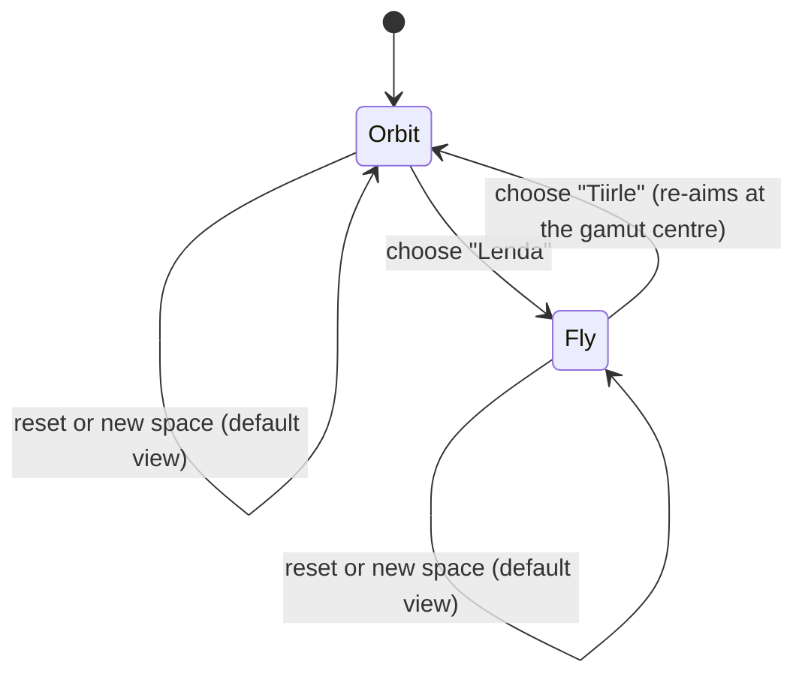
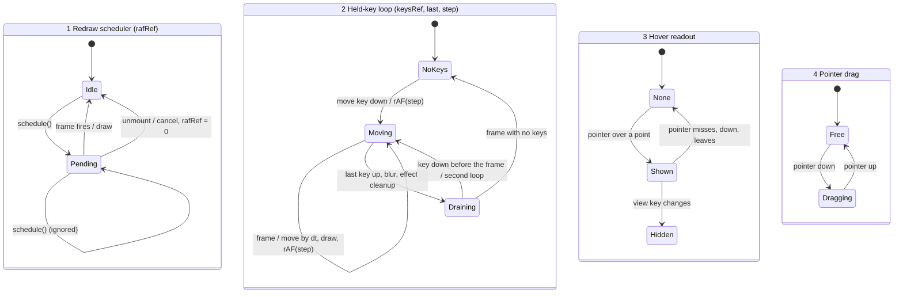

# 3D colour-space view

Status: implicit
Code locations:
- `src/components/results/GamutSection.tsx`: `spaceId`, `hueCenter`, `hueWidth`, `chroma`, `includeNeutrals`, `showImage`, `mode`, `resetKey`, `background`
- `src/components/results/GamutCanvas.tsx`: the camera (a ref), held keys (a ref), `hover` (scoped to a view key)

Decision:
- Settings and camera: keep implicit. [UNDERSTANDING] The settings are independent values, every combination is valid, and the selection is derived from them.
- Redraw scheduler and held-key loop (machines 1 and 2 below): `state-machine-analyst` recommends making them explicit as one tested frame-loop helper; awaiting the user's go-ahead (Standing rule 9).
- Hover readout and pointer drag (machines 3 and 4): keep implicit, with small fixes.

Analysis: `state-machine-analyst`, 2026-11-18, after the blank-canvas bug in `docs/bugs/README.md`. Its findings are tagged [AUDIT: state-machine-analyst] below.

## Diagram (camera)

## States

| State | Meaning | Source |
|---|---|---|
| Orbit | The camera looks at the gamut centre (L 0.5); its distance stays within 0.3–6 | [PROMPT P-035], [UNDERSTANDING] limits |
| Fly | The camera moves freely; pitch stays within ±89° | [PROMPT P-035] "move around the camera in open space" |
| Invalid selection | The chroma minimum is above the maximum: nothing is selected and an alert shows | [PROMPT P-036] item 2, parity with cell 19 |

## Transitions

| From | Event | Guard | To | Source |
|---|---|---|---|---|
| any | choose a space | – | same mode, default view, new lattice, the space's default chroma | [UNDERSTANDING] |
| Orbit | choose "Lenda" | – | Fly from the current position | [UNDERSTANDING] |
| Fly | choose "Tiirle" | – | Orbit around the centre from the current position | [UNDERSTANDING] |
| any | key held | the view has focus | moves every frame until released | [UNDERSTANDING] |
| any | the view loses focus | – | held keys are dropped | [UNDERSTANDING] |
| any | chroma minimum > maximum | – | Invalid selection | [PROMPT P-036] item 2 |

## Unknowns

- A resize during a key-held move: the next frame uses the new size. [UNDERSTANDING] Harmless.
- Touch devices: drag works; there is no pinch-zoom or on-screen fly control. [UNDERSTANDING] Not requested.

## Canvas machines (GamutCanvas.tsx)

Four further implicit machines live in `src/components/results/GamutCanvas.tsx`.

| Machine | State lives in | Invalid combinations [AUDIT: state-machine-analyst] | Verdict |
|---|---|---|---|
| 1 Redraw scheduler | `rafRef`, `schedule`, the unmount cleanup | A pending id with no queued frame: the logged blank-canvas bug, fixed by resetting the id. A frame can also draw twice while a key loop runs (wasted work) | Make explicit (with 2), awaiting approval |
| 2 Held-key loop | `keysRef`, `last`, `step`, `onKey` | Two loops at once when one key is released and another pressed within a frame (extra full redraws). A loop from an earlier effect can keep running with the old mode. A key stays held after Shift changes its name (`=` vs `+`). Ctrl/Cmd shortcuts are swallowed | Make explicit (with 1), awaiting approval |
| 3 Hover readout | `hover` scoped by `view` | Reappears after switching space and back; stays while the wheel or keys move the camera; the `pointerleave` listener is not removed on cleanup | Keep implicit; small fixes |
| 4 Pointer drag | `drag` (effect-local) | Stays set after a cancelled touch or a release outside the canvas without capture; multi-touch jumps | Keep implicit; small fixes |
