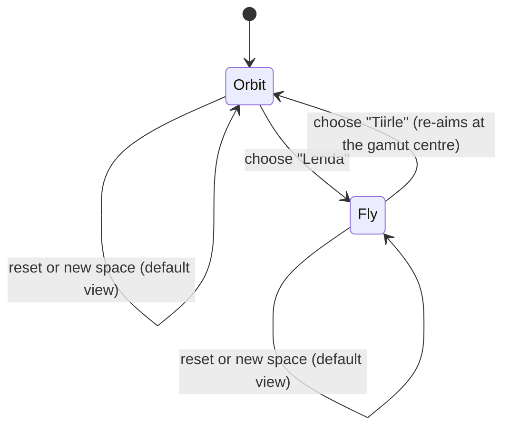

# 3D colour-space view

Status: implicit
Code locations:
- `src/components/results/GamutSection.tsx`: `spaceId`, `hueCenter`, `hueWidth`, `chroma`, `includeNeutrals`, `showImage`, `mode`, `resetKey`, `background`
- `src/components/results/GamutCanvas.tsx`: the camera (a ref), held keys (a ref), `hover` (scoped to a view key)

Decision: keep implicit. [UNDERSTANDING] The settings are independent values, every combination is valid, and the selection is derived from them. The coupled transitions (a new space or a reset gives the default camera and makes a hover readout stale) are handled by deriving from a view key. Not analysed by `state-machine-analyst`; the bugs found while building it are logged in `docs/bugs/README.md`.
Analysis: none

## Diagram (camera)

## States

| State | Meaning | Source |
|---|---|---|
| Orbit | The camera looks at the gamut centre (L 0.5); its distance stays within 0.3–6 | [PROMPT P-035], [UNDERSTANDING] limits |
| Fly | The camera moves freely; pitch stays within ±89° | [PROMPT P-035] "move around the camera in open space" |
| Invalid selection | The chroma minimum is above the maximum: nothing is selected and an alert shows | [PROMPT P-036] item 2, parity with cell 19 |

## Transitions

| From | Event | Guard | To | Source |
|---|---|---|---|---|
| any | choose a space | – | same mode, default view, new lattice, the space's default chroma | [UNDERSTANDING] |
| Orbit | choose "Lenda" | – | Fly from the current position | [UNDERSTANDING] |
| Fly | choose "Tiirle" | – | Orbit around the centre from the current position | [UNDERSTANDING] |
| any | key held | the view has focus | moves every frame until released | [UNDERSTANDING] |
| any | the view loses focus | – | held keys are dropped | [UNDERSTANDING] |
| any | chroma minimum > maximum | – | Invalid selection | [PROMPT P-036] item 2 |

## Unknowns

- A resize during a key-held move: the next frame uses the new size. [UNDERSTANDING] Harmless.
- Touch devices: drag works; there is no pinch-zoom or on-screen fly control. [UNDERSTANDING] Not requested.
