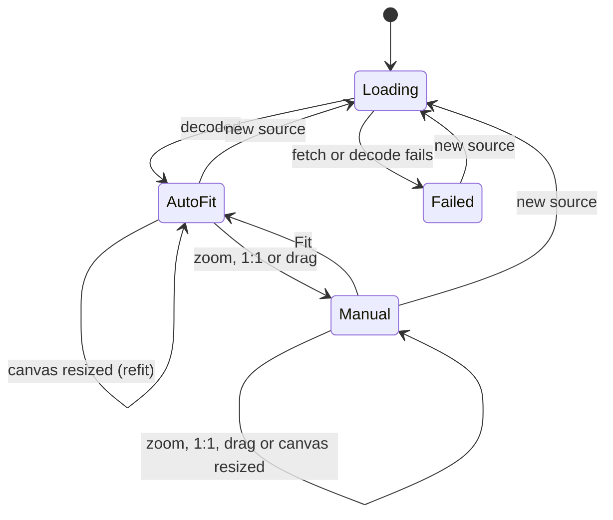

# Pixel viewer

Status: implicit
Code locations: `src/components/preview/PixelViewer.tsx`
- `decoded` against `source`: loading, ready or failed
- `manual` against the current image: auto-fit or manual view
- `drag` ref: dragging or not

Decision: keep implicit. [UNDERSTANDING] Each part is one or two values derived during render, and the risky combinations (a stale view or a stale readout after the image changes) are ruled out by keying both on the image. Not analysed by `state-machine-analyst`, because no shipped bug has come from it.
Analysis: none

## Diagram

## States

| State | Meaning | Source |
|---|---|---|
| Loading | "Avan pilti…", buttons disabled | [UNDERSTANDING] |
| AutoFit | The view is the largest whole-number zoom that fits, centred, and follows canvas resizes | [UNDERSTANDING] the reference viewer fits on first sizing; following later resizes fixes a too-small first fit (P-021 item 2) |
| Manual | The view the user chose; canvas resizes keep it | [UNDERSTANDING] |
| Failed | Error message, buttons disabled: either the browser cannot decode exactly, or the image is over 4096 × 4096 pixels | [PROMPT P-020] item 6: "the preview shows an error instead of an inexact decode"; size limit per P-021 item 3 |

Initial state: Loading. No final state.

## Transitions

| From | Event | Guard | To | Source |
|---|---|---|---|---|
| Loading | decoded | at most `MAX_PREVIEW_PIXELS` | AutoFit | [PROMPT P-019] "add a exact pixel viewer like preview when a user adds a file" |
| Loading | fetch fails (URL source) or `createImageBitmap` rejects | — | Failed | [PROMPT P-020] item 6 |
| Loading | decoded | more than `MAX_PREVIEW_PIXELS` | Failed, with a size message | P-021 item 3 |
| AutoFit | canvas resized | — | AutoFit, refitted | [UNDERSTANDING] |
| AutoFit, Manual | −, +, Ctrl + scroll, keys + − 1, 1:1, drag | image decoded | Manual | [UNDERSTANDING] ported from the reference viewer; plain scrolling is left to the page (P-021 item 1) |
| Manual | Fit button or key 0 | — | AutoFit | [UNDERSTANDING] |
| any | new `source` | — | Loading; the old image, view and readout are dropped | P-021 item 4 |

Pointer move shows the stored value under the cursor in every state with an image; it never changes the state. The readout is cleared when the pointer leaves or the image changes.

## Unknowns

- A new source while the old one is still decoding: [UNDERSTANDING] the old result is ignored, because the effect for the old source is cancelled. Not tested.
- Images near the 4096 × 4096 limit: `performance-analyst` estimates a one-time main-thread pause of tens of ms and about 128 MB while decoding. Not measured.
- Animated GIF: only the first frame is shown (library audit).
- JPEG: values are exact for this browser's decoder, which may differ from other browsers (library audit).
- Touch pinch-zoom: not supported; touch drags pan.
