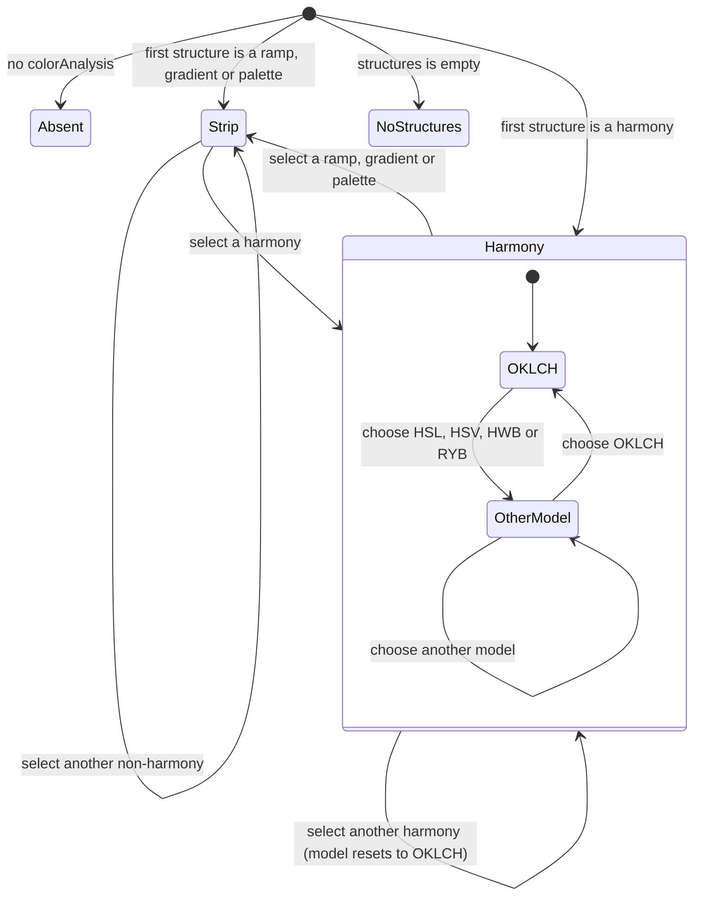

# Results colour analysis

Status: implicit
Code locations:
- `src/components/results/ColorAnalysisSection.tsx`: `selectedId` (which structure is shown)
- `src/components/results/StructureWheel.tsx`: `model` (which colour model's wheel); the hover or focus reveal is CSS only (`group-hover`, `group-focus-within`)
- `src/components/results/ResultsView.tsx`: the section exists only when `analysis.colorAnalysis` is present

Decision: keep implicit. [UNDERSTANDING] Two independent values. The wheel is keyed on the structure id, so selecting another structure resets the model to OKLCH, and no stale combination can exist. Not analysed by `state-machine-analyst`, because no bug has come from it.
Analysis: none

## Diagram

## States

| State | Meaning | Source |
|---|---|---|
| Absent | The server sent no `colorAnalysis`; the section is not rendered | [UNDERSTANDING] `colorAnalysis` is optional in the port |
| NoStructures | The section shows the status note, pipeline and findings only | [UNDERSTANDING] |
| Harmony / OKLCH | The wheel in OKLCH, the default | [PROMPT P-030] "default view is oklch" |
| Harmony / OtherModel | The wheel re-placed on HSL, HSV, HWB or RYB hue; the structure's own model is labelled "algne ratas" | [PROMPT P-030] "on hover they can choose other colomodels to see how it would be placed there" |
| Strip | Ramps and others shown as a strip with step ΔE | [PROMPT P-030] "a gradiant of colors with a same lightness where every color is some delta E apart" |

## Transitions

| From | Event | Guard | To | Source |
|---|---|---|---|---|
| (load) | analysis arrives | `colorAnalysis` absent | Absent | [UNDERSTANDING] |
| (load) | analysis arrives | first structure's family is `harmony` | Harmony / OKLCH | [UNDERSTANDING] the first structure is selected |
| (load) | analysis arrives | first structure is not a harmony | Strip | [UNDERSTANDING] |
| (load) | analysis arrives | no structures | NoStructures | [UNDERSTANDING] |
| Harmony / any | select structure | harmony | Harmony / OKLCH | [UNDERSTANDING] keyed remount |
| Harmony / any | select structure | not a harmony | Strip | [UNDERSTANDING] |
| Strip | select structure | harmony | Harmony / OKLCH | [UNDERSTANDING] |
| Harmony / OKLCH | press a model button | – | Harmony / OtherModel | [PROMPT P-031 item 4] |
| Harmony / OtherModel | press OKLCH | – | Harmony / OKLCH | [UNDERSTANDING] |

The model buttons are always in the DOM and keyboard-reachable. The inactive ones are dimmed (40 % opacity) until the wheel is hovered or anything inside it has focus, so they can still be found and tapped on touch devices; the active one is always fully visible.

## Colour table filters (#70)

Code: `src/components/results/ColorTableSection.tsx` (`filter`: band, cluster, artefact). Status: implicit, kept implicit [UNDERSTANDING]: one value object, every combination valid, keyed on the analysis id so a new analysis starts unfiltered.

| From | Event | To | Source |
|---|---|---|---|
| Unfiltered | choose a share band, cluster or artefact class | Filtered (that part set) | [PROMPT P-032] "add filtering by equivalance class" |
| Filtered | choose another value in the same group | Filtered (replaced) | [UNDERSTANDING] one value per group |
| Filtered | choose "kõik" in every group | Unfiltered | [UNDERSTANDING] |
| Filtered | the matches are empty | Filtered, "Ükski värv ei vasta filtrile." | [UNDERSTANDING] |

Groups combine with AND [PROMPT P-033 item 2]. Filters run over every colour held and show up to N matches [PROMPT P-033 item 3]. Colours without an artefact value match neither "tõenäoline" nor "puhas" [UNDERSTANDING].

## Unknowns

- A new analysis for the same page (re-fetch) whose structure ids no longer contain `selectedId`: `selected` becomes undefined and the right column is empty until the user selects again. [UNDERSTANDING] The results page does not re-fetch today, so this cannot happen yet.
