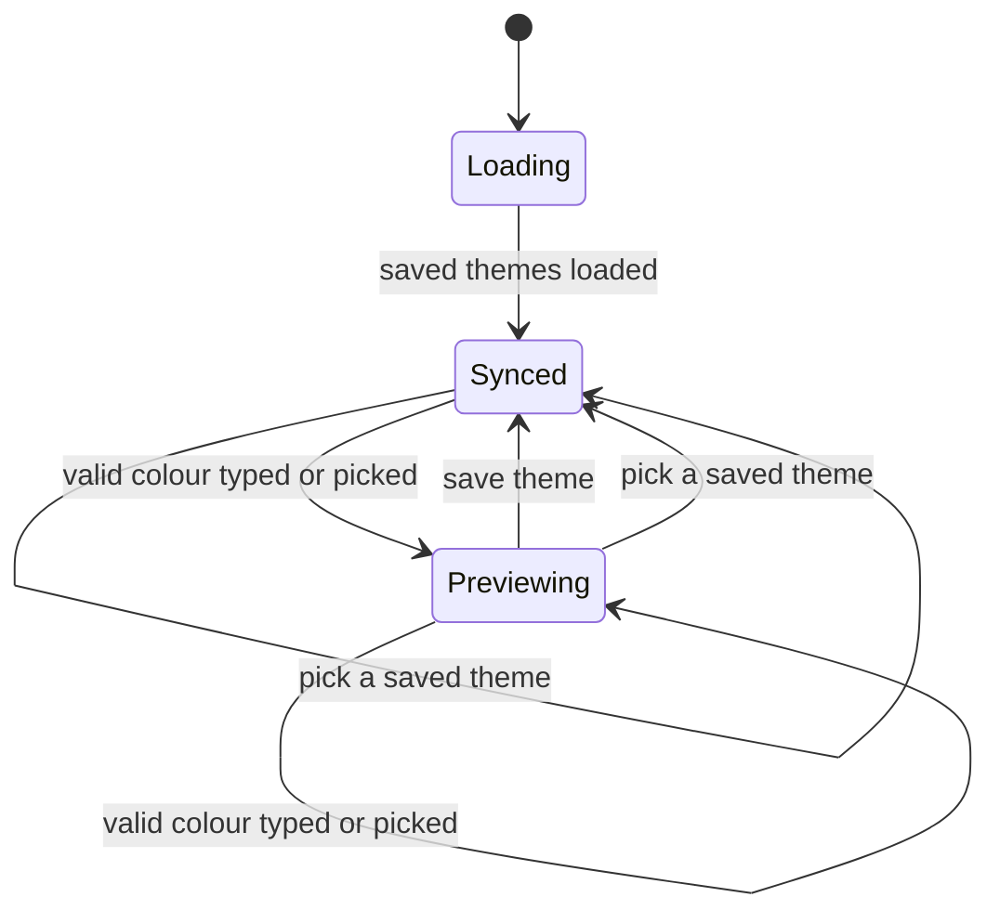
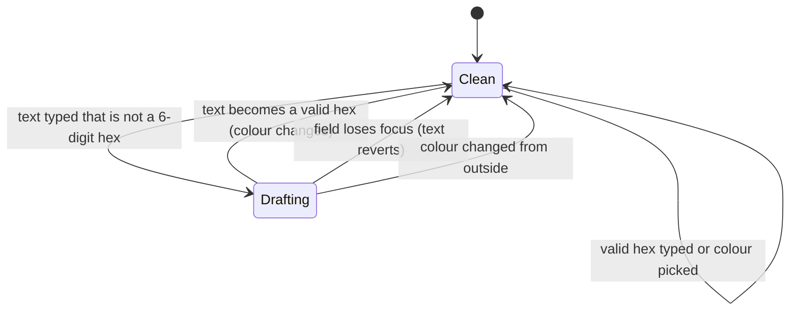

# Theme picker

Status: implicit
Code locations:
- `src/components/theme/ThemeProvider.tsx`: saved `state` and unsaved `preview`
- `src/components/theme/ColorField.tsx`: draft `text` against the committed `value`

Decision: keep implicit. [UNDERSTANDING] Two small pieces of state; the one risky combination is listed under Unknowns. Not analysed by `state-machine-analyst`, because no bug has come from it.
Analysis: none

## Diagram

Per colour field (sub-machine):

## States

| State | Meaning | Source |
|---|---|---|
| Loading | Page shows the default theme (#ffffff / #111111) until the browser store answers | [UNDERSTANDING] defaults from the original `_default_store()` |
| Synced | Page colours equal the current saved theme | [UNDERSTANDING] |
| Previewing | Page shows colours that are not saved yet ("live preview" in the original `theme.js`) | [UNDERSTANDING] |
| Clean | Field text equals its colour | [UNDERSTANDING] |
| Drafting | Field text is half typed; the colour keeps its last valid value | [UNDERSTANDING] a change from the original, which replaced invalid text on every keystroke |

Initial states: Loading, Clean. No final state.

## Transitions

| From | Event | Guard | To | Source |
|---|---|---|---|---|
| Loading | saved themes loaded | — | Synced (current theme applied) | [PROMPT P-017] "take the frontend from it and convert it into nextjs"; storage per P-018 item 2 |
| Synced, Previewing | colour typed or picked | valid `#rrggbb` (a missing `#` is added) | Previewing | same |
| Previewing | "Salvesta teema" | — | Synced; theme added unless the same colours exist, and made current | same |
| Synced, Previewing | saved theme picked | id exists | Synced | same |
| Clean | text typed | not a 6-digit hex | Drafting | [UNDERSTANDING] |
| Drafting | blur | — | Clean, text reverts to the colour | [UNDERSTANDING] |

Every page colour is applied as `oklch(from <hex> l c h)` (P-018 item 4).

## Unknowns

- Colour edited while Loading: [UNDERSTANDING] the load result then replaces the preview, so the edit is lost. Not tested.
- Saving when storage throws: the theme stays in memory for this visit only, with no message.
- Two tabs saving at the same time: the last write wins, with no message.
- More than 7 characters typed: blocked by `maxLength` (tested).
