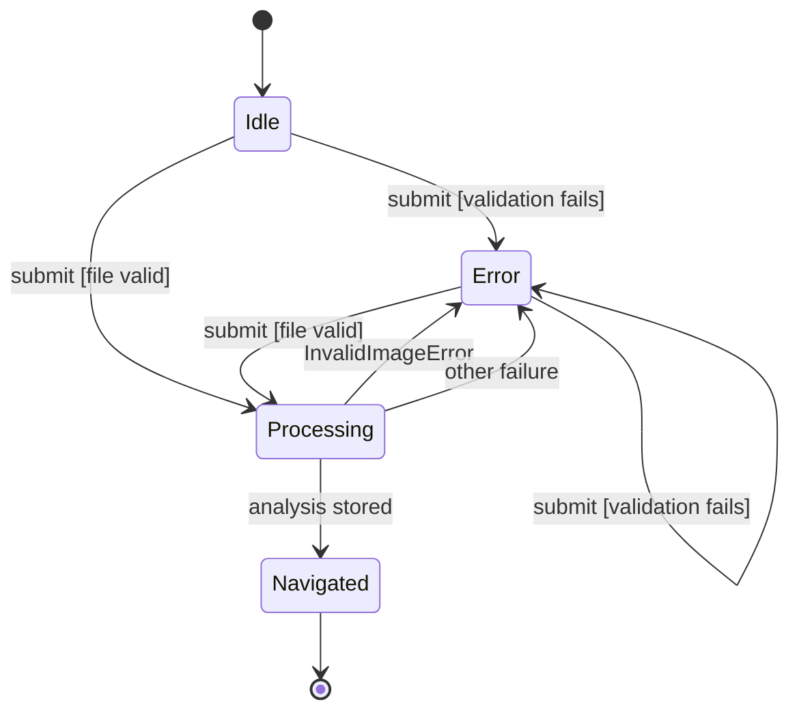

# Upload form

Status: implicit
Code locations: `src/components/upload/UploadForm.tsx` (`error` and `processing` state, `handleSubmit`)
Decision: keep implicit. [UNDERSTANDING] Two flags, one component, and the invalid combination is unreachable (see Unknowns). Not analysed by `state-machine-analyst`, because no bug has come from it.
Analysis: none

## Diagram

## States

| State | Meaning | Flags | Source |
|---|---|---|---|
| Idle | Form shown, no message | `error = null`, `processing = false` | [AUDIT: prompt-compliance-reviewer, 2026-11-17] names idle, processing, error and navigated |
| Error | Form shown with one message, button enabled | `error ≠ null`, `processing = false` | [AUDIT: same] |
| Processing | Analysis running, button disabled and reads "Töötlen…" | `error = null`, `processing = true` | [AUDIT: same] |
| Navigated | Browser moves to `/results/<id>`. Final state | `processing = true` stays set | [AUDIT: same] |

Initial state: Idle. Final state: Navigated.

## Transitions

| From | Event | Guard | To | Source |
|---|---|---|---|---|
| Idle, Error | submit | no file picked | Error: "Faili pole valitud." | [UNDERSTANDING] ported from the original `routes.py` flash messages, per [PROMPT P-017] "take the frontend from it and convert it into nextjs" |
| Idle, Error | submit | extension not png, jpg, jpeg, bmp, gif, webp (TIFF dropped, P-018 item 6) | Error: file type message | same |
| Idle, Error | submit | size > 25 MB (exactly 25 MB passes) | Error: size message | same |
| Idle, Error | submit | file valid | Processing (message cleared) | same |
| Processing | analysis stored | — | Navigated | same |
| Processing | `InvalidImageError` | — | Error: "See fail ei paista olevat korrektne pilt." | same |
| Processing | any other error | — | Error: "Töötlemine ebaõnnestus: <name>: <message>" | same |

Changing the file, the alpha checkbox or top N does not change the state. Top N is clamped to 1–5000 at submit.

## Unknowns

- `error ≠ null` with `processing = true`: [UNDERSTANDING] unreachable, because submit clears the message before it sets `processing`.
- Submit while Processing: [UNDERSTANDING] the disabled button blocks clicks and implicit submission with Enter. Not tested.
- Navigation fails after the analysis is stored: no defined behaviour; the button stays disabled.
- The component unmounts while Processing: no defined behaviour; the later state update is dropped.
