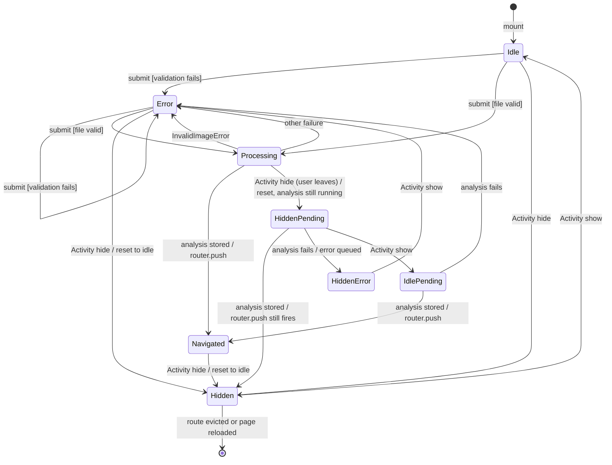

# Upload form

Status: implicit
Code locations: `src/components/upload/UploadForm.tsx` (`error` and `processing` state, `handleSubmit`, the `useLayoutEffect` cleanup)
Decision: keep implicit. [AUDIT: state-machine-analyst, 2026-11-19, after #86] Two flags in one component, and the only invalid flag combination is unreachable (see Unknowns). A reducer would not fix the late-result cases either, because they come from a promise outliving the attempt, not from the flags.
Analysis: `state-machine-analyst`, 2026-11-19, for bug #86 (`docs/bugs/README.md`)

## Diagram

## States

| State | Meaning | Flags | Source |
|---|---|---|---|
| Idle | Form shown, no message | `error = null`, `processing = false` | [AUDIT: prompt-compliance-reviewer, 2026-11-17] names idle, processing, error and navigated |
| Error | Form shown with one message, button enabled | `error ≠ null`, `processing = false` | [AUDIT: same] |
| Processing | Analysis running, button disabled and reads "Töötlen…" | `error = null`, `processing = true` | [AUDIT: same] |
| Navigated | `router.push` called, page about to be hidden. Button stays disabled, which blocks a double submit | `processing = true` | [AUDIT: same]; no longer final [AUDIT: state-machine-analyst, 2026-11-19] |
| Hidden | Next.js keeps the page in `<Activity mode="hidden">` (`cacheComponents: true`); state and DOM kept | `error = null`, `processing = false` | [AUDIT: state-machine-analyst, 2026-11-19]; behaviour of Next.js 16 per #86 |
| HiddenPending, IdlePending, HiddenError | Hidden or shown again while an analysis from this instance is still running, or after it failed while hidden | see Unknowns | [UNDERSTANDING] from the analysis; untested |

Initial state: Idle. No final state: the instance lives until Next.js evicts the hidden route or the page reloads.

## Transitions

| From | Event | Guard | To | Source |
|---|---|---|---|---|
| Idle, Error | submit | no file picked | Error: "Faili pole valitud." | [UNDERSTANDING] ported from the original `routes.py` flash messages, per [PROMPT P-017] "take the frontend from it and convert it into nextjs" |
| Idle, Error | submit | extension not png, jpg, jpeg, bmp, gif, webp (TIFF dropped, P-018 item 6) | Error: file type message | same |
| Idle, Error | submit | size > 25 MB (exactly 25 MB passes) | Error: size message | same |
| Idle, Error | submit | file valid | Processing (message cleared) | same |
| Processing | analysis stored | — | Navigated | same |
| Processing | `InvalidImageError` | — | Error: "See fail ei paista olevat korrektne pilt." | same |
| Processing | any other error | — | Error: "Töötlemine ebaõnnestus: <name>: <message>" | same |
| any | Activity hide (navigation away) | — | Hidden; the layout effect cleanup sets `processing = false`, `error = null` | [AUDIT: #86 fix, `UploadForm.test.tsx` "UploadForm hidden by Next.js"] |
| Hidden | Activity show ("Töötle teine pilt", Back) | — | Idle; the picked file, alpha option and top N stay | same |

Changing the file, the alpha checkbox or top N does not change the state. Top N is clamped to 1–5000 at submit.

## Unknowns

- `error ≠ null` with `processing = true`: [UNDERSTANDING] unreachable, because submit clears the message before it sets `processing`, and every path that sets a message also clears `processing`.
- Submit while Processing: [UNDERSTANDING] the disabled button blocks clicks and implicit submission with Enter. Not tested.
- IdlePending: [UNDERSTANDING] leave while Processing (for example "Ava demo", which is never disabled) and come back before the analysis settles. The button is enabled, so a second submit can run alongside the first; the first result may navigate or show an error during the second. Not tested.
- HiddenPending resolves: [UNDERSTANDING] the late `router.push` still fires and pulls the user away from the page they moved to. The same happens after a real unmount. No requirement in `docs/prompts.md` says whether a late result should navigate or be dropped. Not tested.
- HiddenPending fails: [UNDERSTANDING] the error is queued on the hidden form and shown on return. Not tested.
- React StrictMode runs the cleanup once at mount in development: [UNDERSTANDING] harmless, the reset values equal the initial ones.
- `analyze` takes no `AbortSignal`, so a running analysis cannot be cancelled. [AUDIT: `analysis-service.ts`]

## Drop zone (#91)

[UNDERSTANDING] Dropping a file is the same event as picking one (`pick`): it sets the file, clears the error and notes extra files. `dragging` is a visual flag only (border highlight), set on dragover and cleared on dragleave or drop. The idle → processing → error/navigated machine above is unchanged.
